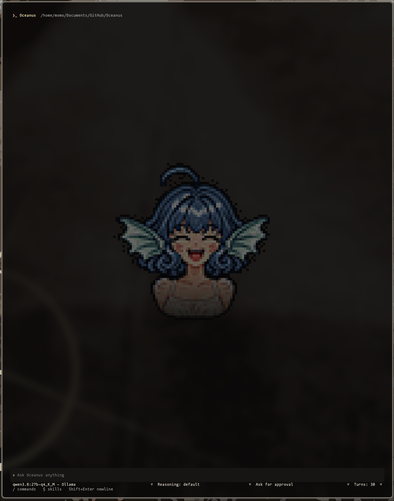

# Oceanus

Oceanus is a terminal-based AI agent for coding and research. Open it in a project directory and give it a task. It can read the code, make an edit, run a check, and use the result to decide what to do next. You can run the model locally with Ollama or use the OpenAI API.

## A look at Oceanus

<a href="./oceanus.png"></a>

## Getting started

You'll need Python 3.11 or newer. On Linux, install your distribution's `bubblewrap` package to let Oceanus run shell commands in its sandbox.

```sh
git clone https://github.com/MomoMizu94/Oceanus.git
cd Oceanus
python3 -m venv .venv
source .venv/bin/activate
python -m pip install -e .
```

Choose how you want to run the model before sending your first prompt.

- For **local inference**, start Ollama with a model that supports tool calls. Oceanus lists installed models from `127.0.0.1:11434`. You can check what's installed with `ollama list`.
- For **OpenAI**, set `OPENAI_API_KEY` in the shell where you launch Oceanus, then select the OpenAI model. With this option, the conversation and tool results used by the model go to the API.

With the virtual environment still active, change into the directory you want Oceanus to work in. For a first run, you can use an empty folder.

```sh
mkdir -p ~/oceanus-demo
cd ~/oceanus-demo
python -m agent_core.tui
```

Type `/model` to pick your model. For a quick tour of file approvals, open `/permissions`, choose **Read Only**, and try the prompt below.

> Create a file called hello.txt containing the words Hello from Oceanus on one line.

Approve the write, then open `hello.txt` to see the result. Oceanus saves your conversation automatically under `~/.local/share/oceanus/sessions/`. To pick up where you left off, use `/exit`, relaunch Oceanus from the same directory, and type `/continue`.

## Common commands

Type `/` in the Oceanus prompt to see the full list. Use the arrow keys to pick a command and press Enter.

| Command | What it does |
| --- | --- |
| `/continue` | Pick up a saved conversation in current directory. |
| `/model` | Choose which model to use. |
| `/reasoning` | Adjust how much the model thinks, if it supports that setting. |
| `/permissions` | Choose when Oceanus asks before taking an action. |
| `/skills` | Pick an installed skill to add to your prompt. |
| `/cancel` | Stop the current task and keep the conversation open. |
| `/exit` | Quit Oceanus when no task is running. |

## Tune it how you like

For conventions Oceanus should follow on every task in a project, put an `AGENTS.md` in that project's root. For a workflow you want to invoke by name, put a `SKILL.md` under `~/.oceanus/skills/<name>/` with a name and description in its YAML frontmatter. Type `$` in the prompt to see your installed skills.

Web search uses Tavily and reads `TAVILY_API_KEY` from the environment. Local image generation uses a separately configured ComfyUI instance. Both are optional for coding tasks.

## Trying it out

If you try Oceanus on one of your projects, I'd like to hear where it helped and where you had to step in. For a bug, open a GitHub issue with the prompt or steps that reproduce it, the model and permission mode you used, and what happened compared with what you expected.
